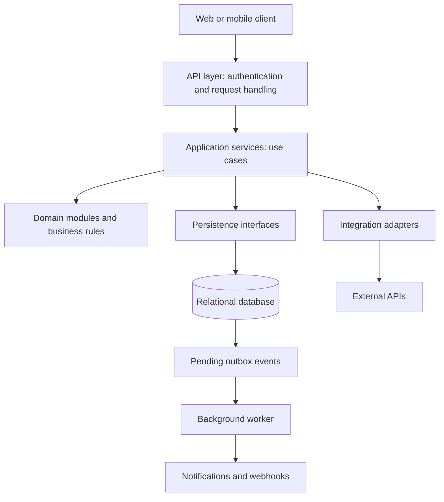
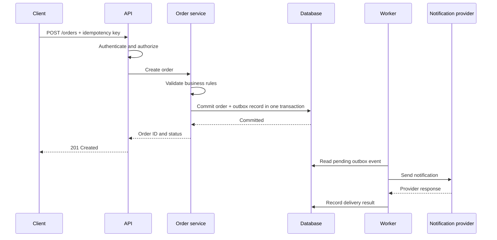

# Custom Software Architecture: Patterns, Trade-offs, and a Practical Blueprint

A practical guide to designing custom business software that is understandable, maintainable, secure, and ready to evolve. It covers how to choose an architecture, define module boundaries, integrate external systems, and prepare for production.

> **Scope:** This is an architecture reference, not a runnable application or a one-size-fits-all production template. The diagrams and examples illustrate design choices; adapt them to your product's requirements.

## Contents

1. [What software architecture should solve](#what-software-architecture-should-solve)
2. [A reference system](#a-reference-system)
3. [High-level architecture](#high-level-architecture)
4. [Module boundaries](#module-boundaries)
5. [A typical business workflow](#a-typical-business-workflow)
6. [Choosing an architecture style](#choosing-an-architecture-style)
7. [Data and integration decisions](#data-and-integration-decisions)
8. [Security and reliability](#security-and-reliability)
9. [A practical design process](#a-practical-design-process)
10. [Further resources](#further-resources)

## What software architecture should solve

Architecture is not simply choosing a framework, cloud provider, or database. It is the set of important decisions that shape how a product behaves as requirements and usage change.

Start by answering questions such as:

- **Business fit:** Which workflows must the software support, and what makes them different from an off-the-shelf solution?
- **Changeability:** Which features are likely to change frequently?
- **Integrations:** Which payment, messaging, ERP, CRM, or other systems need to exchange data?
- **Non-functional requirements:** What availability, response-time, security, retention, and auditability targets actually matter?
- **Operational ownership:** Who will deploy, monitor, maintain, and support the product?

A good architecture makes important changes easier without adding complexity that the business cannot justify.

## A reference system

Consider a B2B order-management platform with:

- A web application for customers and internal staff.
- Order creation, status tracking, and an inventory check.
- An external payment or accounting provider.
- Email and webhook notifications.
- Role-based access and separation between customer organizations.

We'll use a **modular monolith** as the starting point: one deployable application with explicit internal module boundaries. This can be a sensible default for many small and medium-sized teams, but it is not universally best.

## High-level architecture

**How to read this diagram:**

- The **API layer** accepts requests and applies authentication and entry-point controls. Authorization must also be enforced at the relevant business-operation and data-access boundaries.
- **Application services** coordinate a use case, such as creating an order.
- **Domain modules** hold business rules, independent of HTTP or database concerns where practical.
- **Persistence interfaces** keep storage details from spreading throughout business logic.
- **Integration adapters** isolate changes in external providers.
- The **outbox and worker** illustrate one way to coordinate database changes with asynchronous side effects; the worker must handle retries and duplicate delivery.

This diagram is conceptual. A production implementation would need additional detail about deployment, trust boundaries, observability, and failure recovery.

## Module boundaries

Separate code by business responsibility rather than putting all controllers, services, and models into giant shared folders.

| Module | Owns | Should not own |
| --- | --- | --- |
| Identity & Access | Users, organizations, roles, authorization policy | Order totals or inventory calculations |
| Catalog & Inventory | Products, stock quantities, reservation rules | Payment-provider response formats |
| Orders | Order lifecycle, pricing decisions, status transitions | Email template rendering |
| Integrations | Provider-specific request and response mapping | Core order rules |
| Notifications | Delivery preferences, templates, dispatch | Authoritative order state |

Boundaries are useful even if every module runs in the same process. If a module needs data owned by another, prefer a clearly defined interface over direct access to its internal tables or implementation details.

## A typical business workflow

Example: a client submits a new order. The API validates the request and permissions. Within a database transaction, the application creates the order and records a notification event. A worker dispatches that event later.

**Important caveats:** Inventory reservation, payment collection, and other business-critical steps need their own specified consistency and failure-handling rules. An outbox helps avoid the database-plus-message dual-write problem; it does **not** guarantee exactly-once delivery. Use idempotent consumers, backoff, dead-letter handling, and a reconciliation strategy when appropriate.

## Choosing an architecture style

| Approach | Consider it when | Main trade-off |
| --- | --- | --- |
| Modular monolith | One team owns most features and a single deployment is acceptable | Module boundaries require discipline; release cycles remain coupled |
| Microservices | Teams need independent deployments or specific components have different scaling/availability needs | More network, operational, data-consistency, and observability complexity |
| Event-driven components | Workflows benefit from asynchronous processing or decoupled reactions | Event contracts, retries, ordering, and troubleshooting become central |
| Serverless functions | Workloads are bursty or event-triggered and the platform's limits fit the use case | Cold starts, platform constraints, and distributed tracing can complicate design |

**Decision rule:** Choose the least complex design that meets your verified requirements. Microservices are not automatically more scalable or better engineered than a modular monolith.

## Data and integration decisions

### Data ownership

- Decide which module is the source of truth for each business entity.
- Define transaction boundaries explicitly.
- Use schema migrations and test them on production-like data.
- Plan archival, retention, and deletion requirements before data grows.

### External APIs

- Set explicit timeouts and bounded retries; retries should be safe for the operation.
- Validate provider responses and handle partial outages.
- Store credentials in an appropriate secret-management system, not in source control.
- Version contracts deliberately and test integrations against realistic failure scenarios.

### Performance

- Start with an expected traffic model and measurable latency objectives.
- Observe actual bottlenecks before introducing caches or additional services.
- Account for query performance, pagination, background jobs, and provider rate limits.

## Security and reliability

Security and operability are architectural requirements, not final-stage add-ons.

- Enforce authorization for every protected operation and tenant-owned resource; never rely on UI visibility alone.
- Use least-privilege accounts and keep secrets out of logs and repositories.
- Encrypt traffic and protect sensitive data according to applicable requirements.
- Record audit events for security-relevant and business-critical actions.
- Add health checks, structured logs, useful metrics, tracing where needed, and alert ownership.
- Define recovery objectives, back up essential data, and periodically test restoration.
- Run automated checks and stage deployments with a rollback or forward-fix plan.

Use the [production-readiness checklist](docs/production-readiness-checklist.md) before a release.

## A practical design process

1. **Map the business workflow.** Identify users, events, edge cases, and integration points.
2. **Write quality-attribute scenarios.** Replace vague goals such as “fast” with measurable targets and test conditions.
3. **Define module boundaries.** Identify domain ownership and allowed dependencies.
4. **Compare viable architectures.** Record constraints, alternatives, and reasons for the selected approach.
5. **Design failure behavior.** Specify what happens on retries, timeouts, partial writes, and provider downtime.
6. **Validate early.** Use a thin vertical slice or proof of concept to test the riskiest assumptions.
7. **Review and evolve.** Revisit architecture after real usage, performance data, and changed business requirements.

For a worked example of recording a trade-off, see [Architecture Decision Record 0001](docs/adr-0001-modular-monolith.md).

## Further resources

- [C4 model](https://c4model.com/) — a useful way to communicate architecture at multiple levels.
- [OWASP Application Security Verification Standard](https://owasp.org/www-project-application-security-verification-standard/) — a structured application-security requirements reference.
- [Architecture Decision Records](https://adr.github.io/) — a lightweight approach to documenting significant decisions.

### About this guide

This educational reference was prepared for **[Unique Software Development](https://uniquesoftwaredev.com/services/)**, a software development company offering custom software and solution engineering services. It is intended as a starting point for technical discussions, not a statement that this exact reference design is used in every client project.

**Contributions:** Issues and pull requests with specific corrections, examples, or better trade-off explanations are welcome.
